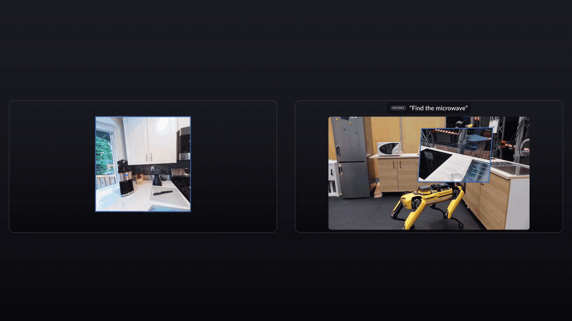

<p align="center">
  <h1 align="center">
    <a href="https://boysun045.github.io/LIME-Page/">
      <picture>
        <source media="(prefers-color-scheme: dark)" srcset="assets/lime_title_dark.svg">
        
      </picture>
    </a>
    <br>Learning Intent-aware Camera Motion from Egocentric Video
  </h1>
  <p align="center">
    <a href="https://boysun045.github.io/boysun-website/">Boyang&nbsp;Sun</a><sup>1,*</sup>
    ·
    <a href="https://jiajieli7012.github.io/">Jiajie&nbsp;Li</a><sup>1,*</sup>
    ·
    <a href="https://royyang0714.github.io/">Yung-Hsu&nbsp;Yang</a><sup>1</sup>
    ·
    <a href="https://zhangcyg.github.io/">Chenyangguang&nbsp;Zhang</a><sup>1</sup>
    ·
    <a href="https://scholar.google.com/citations?user=Ig5T__8AAAAJ">Tim&nbsp;Engelbracht</a><sup>1</sup>
    <br>
    <a href="https://sunghwanhong.github.io/">Sunghwan&nbsp;Hong</a><sup>1</sup>
    ·
    <a href="https://cesarcadena.ethz.ch/">Cesar&nbsp;Cadena</a><sup>1</sup>
    ·
    <a href="https://scholar.google.com/citations?user=YYH0BjEAAAAJ">Marc&nbsp;Pollefeys</a><sup>1,2</sup>
    ·
    <a href="https://hermannblum.net/">Hermann&nbsp;Blum</a><sup>3</sup>
  </p>
  <p align="center">
    <sup>1</sup>ETH Zürich &nbsp; <sup>2</sup>Microsoft &nbsp; <sup>3</sup>University of Bonn
    <br>
    <sup>*</sup>Equal contribution
  </p>
  <h2 align="center">
  <strong>CoRL 2026</strong> <br>
  <a href="https://arxiv.org/abs/2607.02417">ArXiv</a> |
  <a href="https://boysun045.github.io/LIME-Page/">Webpage</a>
  </h2>
</p>

<p align="center">
  <!-- When the full video is online, add a Video link to the header above. -->
  <a href="assets/teaser.mp4">
    
  </a>
  <br>
  <em>
    Given one RGB image and a free-form intent, LIME predicts where the camera should move
    next: a relative target pose, and a description of what the new view should reveal.
  </em>
</p>

## Quick Start
- 🔧 [Setup](#setup) — Create the environment and download the weights.
- 🚀 [Prediction](#prediction) — Predict camera motion from an image and an intent.
- 🖥️ [Interactive Demo](#interactive-demo) — Try intents in the browser and see the predicted cameras in 3D.

## Setup

Clone the repository, then create the environment and download the weights:

```bash
git clone https://github.com/cvg/LIME.git && cd LIME
```
```bash
bash scripts/setup_env.sh
conda activate lime
```

`setup_env.sh` creates the conda environment `lime` from `environment.yml` (Python 3.11,
PyTorch 2.8 with CUDA 12.8), checks that PyTorch sees your GPU, and downloads the weights
(8.9 GB) from [Hugging Face](https://huggingface.co/BoboSun/LIME) to `weights/lime_v1`. Run
it again to resume an interrupted download. You need conda and an NVIDIA GPU with about
9 GB of memory, with a driver that supports CUDA 12.

<details>
<summary><b>[Optional - click to expand] Install with pip, or for another CUDA</b></summary>

```bash
conda create -n lime python=3.11 -y && conda activate lime
pip install torch==2.8.0+cu128 torchvision==0.23.0+cu128 \
    --extra-index-url https://download.pytorch.org/whl/cu128
pip install -r requirements.txt
pip install -e . --no-deps
bash scripts/download_weights.sh
```

For another CUDA, change `cu128` in the torch line, or in `environment.yml` before running
`setup_env.sh`.

</details>

## Prediction

### Command line

```bash
python scripts/predict.py --image examples/living_room.jpg --intent "Find my bike." --seed 0
```

This prints JSON with the generated `observation_gain` text, the mean target pose `T_mean`
and the K sampled poses `T_samples`. Repeat `--intent` to run several on one image, and
write to a file with `--out`. `--samples` sets K (default 5) and `--steps` the Euler
steps (default 10).

### Python

```python
from lime_camera import LIME

model = LIME.from_pretrained("weights/lime_v1")
prediction = model.predict("examples/living_room.jpg", "Find my bike.", n_samples=5, seed=0)

prediction.observation_gain     # what the new view should reveal
prediction.T_mean               # 4x4 target pose, the mean of the K samples
prediction.T_samples            # (K, 4, 4) sampled target poses
```

The image is a file path or a PIL image. The text is deterministic, and `seed` fixes the
pose samples. The paper executes the mean of K=5 samples.

**Poses** are the end camera in the start camera's frame, in metres, with OpenCV axes
(x right, y down, z forward), so `tz > 0` moves forward. With a known start pose, the
target is `T_world_end = T_world_start @ T_mean`. A prediction takes about 1 s on an
RTX 4090, and about 18 s on CPU.

## Interactive Demo

<!-- DEMO SCREENSHOT PLACEHOLDER: add a screenshot or GIF of the demo here, e.g. assets/demo.gif -->

```bash
bash scripts/run_demo.sh
```

Once the model has loaded, it prints where to open the demo:

- **On the same machine:** open <http://localhost:8080>.
- **From another computer:** run `ssh -N -L 8080:localhost:8080 user@gpu-machine` there,
  then open <http://localhost:8080>. VS Code Remote-SSH forwards the port for you.

Type an intent or press a preset, and the predicted cameras appear in the room with the
generated text. The example image is a frame from
[ScanNet++](https://kaldir.vc.in.tum.de/scannetpp/). Its point cloud was estimated from the
image alone with [MoGe-2](https://github.com/microsoft/MoGe), ahead of time and for display
only: the model sees nothing but the RGB image and the intent.

To use your own image:

```bash
bash scripts/run_demo.sh --image path/to/room.jpg
```

Without a point cloud you see the cameras only. To add one and preset intents, put
`room_points.npz` and `room_command.json` (one intent per line) next to the image, as in
`examples/`. If port 8080 is taken, the demo uses the next free one. `--host 0.0.0.0`
serves your whole network, without a password.

<details>
<summary><b>[Optional - click to expand] ScanNet++ scenes</b></summary>

On a [ScanNet++](https://kaldir.vc.in.tum.de/scannetpp/) frame, the cameras are drawn
into the scene's ground-truth mesh:

```bash
bash scripts/run_demo.sh --scene-root /path/to/scannetpp/data/09c1414f1b --frame frame_003943
```

The scene folder needs `iphone/rgb/<frame>.jpg`, `iphone/pose_intrinsic_imu.json`,
`iphone/depth.bin` and `scans/mesh_aligned_0.05.ply`.

</details>

## ✅ TODO
- [x] Inference code and the `lime_v1` weights.
- [x] Interactive demo.
- [ ] Training code.
- [ ] Data generation pipeline.

## 📜 License

The code is released under the [Apache-2.0 license](LICENSE).

The weights are released under [CC BY-NC 4.0](https://creativecommons.org/licenses/by-nc/4.0/),
for non-commercial use. They are a modified version of
[Qwen3-VL-4B-Instruct](https://huggingface.co/Qwen/Qwen3-VL-4B-Instruct) (Apache-2.0); see
the [model card](https://huggingface.co/BoboSun/LIME) for both licenses.

## 📖 Citation

If you use any ideas from the paper or code from this repo, please consider citing:

```bibtex
@inproceedings{sun2026lime,
  title={LIME: Learning Intent-aware Camera Motion from Egocentric Video},
  author={Sun, Boyang and Li, Jiajie and Yang, Yung-Hsu and Zhang, Chenyangguang
          and Engelbracht, Tim and Hong, Sunghwan and Cadena, Cesar
          and Pollefeys, Marc and Blum, Hermann},
  booktitle={Conference on Robot Learning (CoRL)},
  year={2026}
}
```

## 📬 Contact

For questions, feedback, or collaboration, feel free to reach out to **Boyang Sun**:

📧 boysun@ethz.ch 🌐 [boysun045.github.io](https://boysun045.github.io/boysun-website/)
